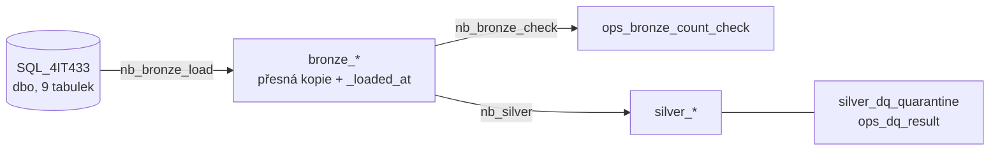

# 4IT433 – tým 06: datová platforma DPP v Microsoft Fabric

Semestrální projekt 4IT433 (VŠE, ZS 2026/27). Workspace DEV týmu 06, lakehouse `lh_team_06` s vrstvami **Bronze**
a **Silver** nad interní databází DPP `SQL_4IT433` (workspace `4IT433_SQL`, schéma `dbo`).

## Milník 1 – přehled

| Notebook          | Co dělá                                                                       |
| ----------------- | ----------------------------------------------------------------------------- |
| `nb_bronze_load`  | načte všech 9 tabulek ze zdroje do `bronze_<tabulka>`                         |
| `nb_bronze_check` | porovná počty řádků zdroj vs. Bronze, výsledek do `ops_bronze_count_check`    |
| `nb_silver`       | z každé `bronze_*` vytvoří `silver_*`, vyhodnotí pravidla kvality dat         |

Pořadí spuštění: `nb_bronze_load` → `nb_bronze_check` → `nb_silver`. Po doběhnutí se Spark session zastavuje
(sdílená kapacita).

## Konvence pojmenování

| Co               | Konvence                                                      | Příklad                                   |
| ---------------- | ------------------------------------------------------------- | ----------------------------------------- |
| Lakehouse        | `lh_team_<číslo týmu>`                                        | `lh_team_06`                              |
| Tabulky          | malá písmena, prefix vrstvy + název zdrojové tabulky          | `bronze_cestujici`, `silver_cestujici`    |
| Provozní tabulky | prefix `ops_`                                                 | `ops_bronze_count_check`, `ops_dq_result` |
| Sloupce Bronze   | beze změny podle zdroje, technické sloupce začínají `_`       | `PERSON_SK`, `_loaded_at`                 |
| Sloupce Silver   | malá písmena a podtržítka                                     | `person_sk`, `inspection_at`              |
| Notebooky        | `nb_<vrstva/krok>`                                            | `nb_bronze_load`                          |
| Commity          | `<oblast>: <co se udělalo>`                                   | `bronze: načtení všech tabulek`           |

## Bronze

- **Přesná kopie zdroje:** názvy sloupců, datové typy i hodnoty beze změny, navíc jen `_loaded_at` (čas načtení).
- **Nástroj:** PySpark notebook, čtení přes JDBC s tokenem identity, která notebook spouští (žádné heslo v kódu).
- **Opakované spuštění bez duplicit:** každá tabulka se zapisuje v režimu `overwrite` – při dalším běhu se celá
  nahradí aktuálním stavem zdroje.
- Sloupce typu `time` (`INSPECTION_TIME`, `INCIDENT_TIME`) převede JDBC ovladač na timestamp s datem 1970-01-01;
  čas dne zůstává zachovaný, datum se k němu připojuje až v Silver.

### Kontrola počtů řádků

Výsledek `nb_bronze_check` (běh _doplnit datum_):

| Tabulka | Počet ve zdroji | Počet v Bronze | Shoda |
| --- | ---: | ---: | :---: |
| _doplnit z výstupu `nb_bronze_check`_ | | | |

## Silver

`nb_silver` přepočítá celý Silver z Bronze při každém běhu – opakovaný běh dá stejný výsledek.

### Společná pravidla

| Oblast            | Pravidlo |
| ----------------- | -------- |
| Názvy sloupců     | malá písmena a podtržítka (`CASE_STATUS` → `case_status`) |
| Texty             | oříznuté okrajové mezery, vícenásobné mezery → jedna, prázdný text → `NULL` |
| Datové typy       | data `date`, časy `timestamp`, částky `decimal(10,2)` (dopočtené `decimal(12,2)`), klíče `bigint`, `Y`/`N` → `boolean` |
| Datum + čas       | spojené do jednoho sloupce `*_at` (`inspection_at`, `incident_at`) |
| Druh dopravy      | ve zdroji dva číselníky (`Tramvaj`, `Autobus` … vs. `TRAM`, `BUS` …) → jeden kód `METRO / TRAM / BUS / TROLLEYBUS / TRAIN / FUNICULAR / FERRY`; původní hodnota v `transport_mode_src` |
| Duplicity         | úplně stejné řádky se odstraní; má-li jeden klíč víc řádků, zůstane ten s nejnovějším `created_at` |
| Chybějící hodnoty | `NULL` se nedoplňuje odhadem. Kde `NULL` znamená stav (ještě nevyřízeno, revizor stále platný), zůstává. Kde jde o chybu, řádek dostane příznak |
| Nesmyslné hodnoty | **ERROR** → řádek jde do `silver_dq_quarantine` a v Silver tabulce není; **WARN** → řádek zůstává, kód pravidla je ve sloupci `dq_flags`. Počty porušení každého běhu jsou v `ops_dq_result` |
| „V budoucnosti“   | porovnává se s časem načtení řádku (`_loaded_at`) |
| Osobní údaje      | jména, adresy, data narození, CRM ID, čísla dokladů, osobní čísla, e-maily a volné texty se do Silver nepřenášejí |

### Pravidla po tabulkách

#### `silver_cestujici` ← CESTUJICI
- Nepřenáší se: jméno, datum narození, adresa, CRM ID, číslo dokladu. Zůstává `person_sk`, `nationality`,
  `document_type`, `residence_city` (obec z adresy) a `birth_year`.
- WARN: chybí jméno (P01), nepravděpodobné datum narození – před 1920 nebo v budoucnosti (P02, `birth_year` je pak
  `NULL`), chybí datum narození (P03), státní příslušnost (P04), typ dokladu (P05).

#### `silver_revizor` ← REVIZOR
- Nepřenáší se osobní číslo zaměstnance. `valid_to = NULL` = revizor je stále platný (ponecháno).
- WARN: `valid_to` před `valid_from` (R01), `is_current` neodpovídá `valid_to` (R02).

#### `silver_prepravni_kontrola` ← PREPRAVNI_KONTROLA
- `inspection_at` = datum + čas kontroly, doplněna `inspection_hour`; `person_id` přejmenováno na `person_sk`.
- `zoppk_number = NULL` u kontrol zaplacených na místě je očekávané (ponecháno).
- WARN: neznámý revizor (K01), kontrola mimo platnost revizora (K02), neznámá osoba (K03), neznámý druh dopravy (K04),
  `paid_on_site` neodpovídá vyplnění ZOPPK (K05), záznam vytvořen před kontrolou (K06), chybí čas kontroly (K07).
- ERROR: kontrola v budoucnosti (K90).

#### `silver_pohledavka` ← POHLEDAVKA
- Doplněno `paid_success_amount` = součet úspěšných plateb.
- WARN: neznámá kontrola (H01), lhůty před datem vystavení (H02), přirážka vyšší než původní (H03), dluh vyšší než
  přirážka (H04), stav PAID s nenulovým dluhem (H05), stav PAID, ale zaplaceno méně (H06).
- ERROR: záporná částka (H90).

#### `silver_platba` ← PLATBA
- `variable_symbol = NULL` u plateb na místě je očekávané (ponecháno).
- WARN: neznámá pohledávka (M01), záznam vytvořen před platbou (M02).
- ERROR: platba v budoucnosti (M90), nulová nebo záporná částka (M91).

#### `silver_collection_vymahani` ← COLLECTION_VYMAHANI
- Doplněno `action_step` (1 upomínka → 2 předání → 3 soud → 4 exekuce). `external_party_id = NULL` u upomínek je
  očekávané.
- WARN: neznámá pohledávka (C01), neznámý typ kroku (C02), záporné náklady (C03).
- ERROR: krok v budoucnosti (C90).

#### `silver_claim_reklamace_pokuty` ← CLAIM_REKLAMACE_POKUTY
- Časy s artefaktem `.999` ms zaokrouhleny dolů na celé sekundy. Doplněno `resolution_days`.
- `resolved_at` / `resolution = NULL` u otevřených reklamací je očekávané.
- WARN: neznámá kontrola (L01), reklamace podaná před kontrolou (L02), stav neodpovídá datu vyřízení (L03), přirážka
  po reklamaci vyšší než před ní (L04).
- ERROR: vyřízení v budoucnosti (L90), vyřízení před podáním (L91).

#### `silver_refund` ← REFUND
- WARN: neznámá reklamace (F01) nebo platba (F02), vratka vyšší než platba (F03), vráceno dřív, než byla vratka
  založena (F04).
- ERROR: vratka v budoucnosti (F90), nulová nebo záporná částka (F91).

#### `silver_podnet_cestujiciho` ← PODNET_CESTUJICIHO
- Nepřenáší se: jméno, příjmení, e-mail, text podnětu. `incident_at` = datum + čas incidentu. `line_id` je
  normalizované číslo linky, `line_reported` a `stop_reported` jsou původní texty cestujícího.
- WARN: incident po podání podnětu (S01), neznámý druh dopravy (S02), číslo linky v nenormalizovaném tvaru (S03),
  zastávka nenapárovaná (S04).
- ERROR: vyřízení v budoucnosti (S90), vyřízení před podáním (S91).

### Výsledky posledního běhu

Běh `nb_silver` 9. 11. 2026.

| Tabulka | Bronze | Úplné duplicity | Duplicitní klíč | Karanténa | Silver |
| --- | ---: | ---: | ---: | ---: | ---: |
| `silver_cestujici` | 61964 | 0 | 0 | 0 | 61964 |
| `silver_revizor` | 300 | 0 | 0 | 0 | 300 |
| `silver_prepravni_kontrola` | 5000 | 0 | 0 | 0 | 5000 |
| `silver_pohledavka` | 5000 | 0 | 0 | 0 | 5000 |
| `silver_platba` | 4582 | 0 | 0 | 1 | 4581 |
| `silver_collection_vymahani` | 976 | 0 | 0 | 0 | 976 |
| `silver_claim_reklamace_pokuty` | 450 | 0 | 0 | 2 | 448 |
| `silver_refund` | 147 | 0 | 0 | 0 | 147 |
| `silver_podnet_cestujiciho` | 809 | 0 | 0 | 11 | 798 |

Ve zdroji nejsou duplicitní řádky ani duplicitní klíče – deduplikace v Silver je pojistka pro budoucí načítání.

**Pravidla, která v datech našla porušení** (ostatní pravidla: 0):

| Pravidlo | Závažnost | Porušení | Co to znamená / rozhodnutí |
| --- | --- | ---: | --- |
| P01_NAME_MISSING | WARN | 5 | osoba bez jména – ponechána (je potřeba kvůli vazbě na kontroly), jméno do Silver stejně nejde |
| P02_BIRTHDATE_IMPLAUSIBLE | WARN | 1353 | narození před rokem 1920 – `birth_year = NULL`, řádek zůstává |
| P04_NATIONALITY_MISSING | WARN | 1 | chybí státní příslušnost – ponecháno jako `NULL` |
| P05_DOCUMENT_MISSING | WARN | 1 | chybí typ dokladu – ponecháno jako `NULL` |
| K02_INSPECTOR_NOT_VALID | WARN | 1 | kontrola revizorem mimo období jeho platnosti (otázka DPP č. 7) – ponecháno s příznakem |
| H06_PAID_BUT_UNDERPAID | WARN | 12 | pohledávka ve stavu PAID, ale úspěšné platby jsou nižší než přirážka – ponecháno s příznakem |
| M90_PAYMENT_IN_FUTURE | ERROR | 1 | platba s časem po okamžiku načtení – karanténa |
| L02_SUBMITTED_BEFORE_INSPECTION | WARN | 2 | reklamace podaná dřív než samotná kontrola – ponecháno s příznakem |
| L90_RESOLVED_IN_FUTURE | ERROR | 2 | reklamace vyřízená v budoucnosti – karanténa |
| S01_INCIDENT_AFTER_SUBMISSION | WARN | 169 | incident nastal až po podání podnětu – ponecháno s příznakem (k ověření s DPP) |
| S03_LINE_NOT_NORMALIZED | WARN | 393 | linka zadaná textem (`bus 119`) – normalizovaná hodnota je v `line_id` |
| S04_STOP_NOT_MATCHED | WARN | 183 | podnět bez napárované zastávky (`stop_id = NULL`) – ponecháno |
| S90_RESOLVED_IN_FUTURE | ERROR | 11 | podnět vyřízený v budoucnosti – karanténa |

Pravidla „v budoucnosti“ se porovnávají s časem načtení, takže počty se s dalšími načteními mohou měnit.

## Práce s Gitem

- Workspace DEV je napojený na větev `dev`, složku `fabric/`. Commity z Fabricu jdou do `dev`.
- README a dokumentace se upravují na GitHubu ve větvi `dev`.
- Do `main` jen přes Pull Request z `dev`, který schválí jiný člen týmu než autor.

## Použití AI asistentů

Při návrhu notebooků a psaní dokumentace jsme používali AI asistenta (Claude). Kód jsme prošli, spustili ve Fabricu
a plně za něj odpovídáme.
